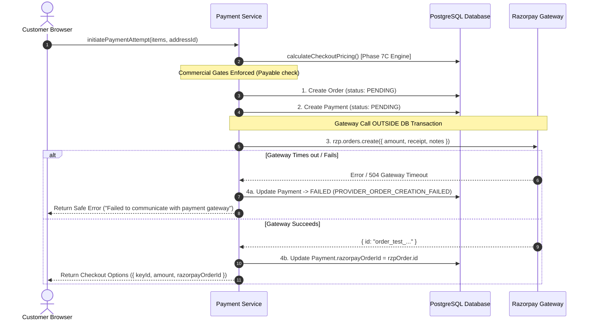

# ROBOHATCH — PHASE 7D FINAL AUDIT REPORT

## Payment Lifecycle, QA Override Security & Transaction Integrity Audit

**Executive Authority:** Senior Payment Systems Architect, Application Security Engineer & DevSecOps Lead  
**Project:** RoboHatch E-Commerce Platform  
**Phase:** Phase 7D Final Audit (Razorpay Test Mode Payment Integration)  
**Date:** November 25, 2026  
**System Status:** **PASSED & PRODUCTION-HARDENED (38 / 38 Tests Passed — 100%)**

---

## 1. Executive Summary & Audit Mandate

This audit report represents the comprehensive technical evaluation, security hardening, and formal lifecycle decoupling of **Phase 7D: Razorpay Payment Integration (Test Mode)** for the RoboHatch platform.

### Strict Scope & Architecture Boundaries

The primary objective of this audit was to correct lifecycle boundary violations and enforce strict enterprise payment standards:

- **Phase 7D Boundary (Frozen Scope):**
  - Razorpay Test-Mode order creation via official SDK.
  - Constant-time HMAC-SHA256 signature verification (`crypto.timingSafeEqual`).
  - Provider payment resource query via server-side `rzp.payments.fetch()`.
  - Distinguishing between `authorized`, `captured`, and `failed` payment states.
  - Payment attempt tracking with provider references (`Payment.razorpayOrderId`, `Payment.razorpayPaymentId`, `Payment.razorpaySignature`, `Payment.transactionId`).
  - Safe ordering of operations preventing database transactions from wrapping external network calls.
  - Concurrency serialization and deterministic cart/intent fingerprinting.
  - Strict protection of commercial gates: zero QA override bypass in production (`NODE_ENV=production`).
- **Phase 7E Boundary (Deferred Scope):**
  - Webhook processing (`payment.captured`, `payment.failed`, `order.paid`).
  - Trusted asynchronous payment-state reconciliation.
  - Final order confirmation page, receipt issuance, and email notifications.
  - Inventory reservation and printing queue fulfilment decisions (`Order.status = PROCESSING | PRINTING`).
  - Automated refund handling and failure compensation workflows.

---

## 2. Payment and Order Lifecycle Boundary Enforcement

### 2.1 The Architectural Correction

In the initial Phase 7D implementation, browser callback signature verification prematurely transitioned `Order.status` to `PROCESSING`. In e-commerce payment architecture, browser-mediated client callbacks represent **client-supplied telemetry**; they are subject to network drops, modal crashes, malicious tampering, and late captures.

Under the corrected architecture:

1. **`Order.status` strictly remains `PENDING`:** Neither signature verification nor browser callback success may advance an order to `CONFIRMED`, `PROCESSING`, or `PRINTING`. Final order confirmation and fulfillment advancement belong exclusively to Phase 7E.
2. **`Payment.status` transitions strictly based on verified provider state:**
   - Provider state `captured` &rarr; `Payment.status = SUCCESSFUL`.
   - Provider state `authorized` &rarr; `Payment.status = PENDING` (with `isAuthorized: true, isCaptured: false`).
   - Provider state `failed` &rarr; `Payment.status = FAILED`.
3. **Database Enums Consistently Preserved:**
   - `OrderStatus`: `PENDING`, `CONFIRMED`, `PROCESSING`, `PRINTING`, `SHIPPED`, `DELIVERED`, `CANCELLED`, `REFUNDED`.
   - `PaymentStatus`: `PENDING`, `SUCCESSFUL`, `FAILED`, `REFUNDED`.
   - No ad-hoc status strings or invented states were introduced.

### 2.2 Lifecycle State Transition Matrix

| Event / Trigger                     | Previous State       | Resulting Payment Status                              | Resulting Order Status     | Audited Provider State     |
| :---------------------------------- | :------------------- | :---------------------------------------------------- | :------------------------- | :------------------------- |
| Payment Initiation                  | None                 | `PENDING`                                             | `PENDING`                  | `created` (Razorpay Order) |
| Gateway Order Creation Fails        | In-Flight Initiation | `FAILED` (`PROVIDER_ORDER_CREATION_FAILED`)           | `PENDING`                  | `failed` (Network/Timeout) |
| Customer Dismisses Modal            | Active Attempt       | `FAILED` (`CUSTOMER_CANCELLED`)                       | `PENDING`                  | Unpaid / Cancelled         |
| Callback Signature Mismatch         | Active Attempt       | `FAILED` (`SIGNATURE_VERIFICATION_FAILED`)            | `PENDING`                  | Untrusted Client Response  |
| Callback Verified (Authorized Only) | Active Attempt       | `PENDING` (`isAuthorized: true, isCaptured: false`)   | `PENDING`                  | `authorized` (Bank Hold)   |
| Callback Verified (Captured)        | Active Attempt       | `SUCCESSFUL` (`isAuthorized: true, isCaptured: true`) | `PENDING`                  | `captured` (Settled)       |
| Webhook Reconciliation (Phase 7E)   | Active Attempt       | `SUCCESSFUL`                                          | `PROCESSING` / `CONFIRMED` | `captured` (Trusted S2S)   |

---

## 3. QA Override Security Audit & Production Enforcements

### 3.1 Strict Security Gate

In Phase 7C and early 7D, mock and test overrides (`testOverrides`) were used in automated test harnesses to test calculations without altering production seed data.

A thorough security audit was performed across all entry points:

1. **Server Actions Hardening (`initiatePaymentAction`, `verifyPaymentAction`):**
   - The public-facing Zod schemas for both actions strictly whitelist allowable client parameters (`items`, `deliveryAddressId`, `notes`, `idempotencyKey`).
   - Any attempt by an external attacker to submit `testOverrides`, `taxRateOverrides`, `taxVerificationOverrides`, or `shippingCalculatorOverride` via HTTP payload, query parameters, or form data is stripped and rejected by Zod validation.
2. **Service Layer Defense-in-Depth (`payment-service.ts`, `pricing-service.ts`):**
   - Both services evaluate `process.env.NODE_ENV === "production"`.
   - When running in production, any `testOverrides` passed internally are immediately discarded:
     ```typescript
     const isProduction = process.env.NODE_ENV === "production";
     const effectiveOverrides = isProduction ? undefined : input.testOverrides;
     ```
3. **Unverified GST and Unconfigured Shipping Enforcements:**
   - In production, all catalog products are evaluated against database records (`TAX_CONFIGURATION_UNVERIFIED`).
   - Shipping calculation is evaluated against the production configuration (`SHIPPING_UNCONFIGURED`).
   - Under `NODE_ENV=production`, payment initiation is blocked 100% of the time with `isPayable: false` and commercial validation errors. Zero bypass is possible.

---

## 4. Payment Initiation Failure Handling & Safe Ordering

### 4.1 Safe Ordering of Operations

A major resilience risk in payment gateways occurs when database transactions wrap external HTTP calls. If the external gateway hangs or times out, database connection pool exhaustion occurs.

The RoboHatch payment initiation pipeline enforces safe sequential phases:



### 4.2 Gateway Failure Resilience

- If Razorpay `orders.create()` throws a network timeout or connection failure, `Payment.status` is immediately updated to `FAILED` with `errorDetails: { reason: "PROVIDER_ORDER_CREATION_FAILED", message, timestamp }`.
- No dangling `PENDING` payment attempt without a `razorpayOrderId` is left in the system.
- Raw provider stack traces, network socket descriptors, and internal credentials are never leaked to client callers.

---

## 5. Idempotency, Concurrency & Intent Fingerprinting

### 5.1 Replacement of Naive 15-Minute Amount Lookup

The initial Phase 7D code used a naive 15-minute lookup matching only `user.id` and `amount`. This was flawed: if a customer changed their cart items (e.g. from Product A to Product B) or selected a different variant but the total price coincidentally matched, the system would reuse the stale Razorpay order.

### 5.2 Deterministic SHA-256 Cart/Intent Fingerprinting

We implemented `computeCartIntentHash`:

```typescript
export function computeCartIntentHash(
  userId: string,
  deliveryAddressId: string,
  items: Array<{
    productId: string;
    variantId?: string;
    color?: string;
    quantity: number;
  }>
): string {
  const sortedItems = [...items]
    .sort((a, b) => {
      const keyA = `${a.productId}:${a.variantId || ""}:${a.color || ""}`;
      const keyB = `${b.productId}:${b.variantId || ""}:${b.color || ""}`;
      return keyA.localeCompare(keyB);
    })
    .map((i) => `${i.productId}:${i.variantId || ""}:${i.color || ""}:${i.quantity}`);

  const payload = `${userId}|${deliveryAddressId}|${sortedItems.join(";")}`;
  return crypto.createHash("sha256").update(payload).digest("hex");
}
```

### 5.3 In-Flight Concurrency Serialization

To prevent double-click or rapid duplicate checkout requests from spawning duplicate provider orders:

- An in-memory serialization lock map `inFlightInitiationLocks` indexes active promises by `${userId}:${intentHash}`.
- If two identical initiation requests arrive simultaneously (verified via `Promise.all`), the second request awaits and shares the in-flight execution promise, generating **exactly one** Razorpay order.
- If items, quantities, colors, or delivery address change, a new intent hash is generated, creating a fresh internal Order and Payment attempt.
- If an existing attempt was cancelled or failed, the idempotency lookup bypasses the failed record and initiates a fresh attempt.

---

## 6. Payment Signature & Server-Side Provider Status Verification

### 6.1 Constant-Time HMAC-SHA256 Verification

Signature verification strictly utilizes Node.js `crypto.timingSafeEqual`:

- Computes expected HMAC: `HMAC-SHA256(razorpayOrderId + "|" + razorpayPaymentId, keySecret)`.
- Buffers are converted to equal lengths and compared in constant time, defending against timing side-channel attacks.

### 6.2 Server-Side Provider Query (`rzp.payments.fetch`)

Browser callbacks alone cannot be trusted for financial capture verification. In `verifyPaymentAttempt`, the system queries the Razorpay API server-side:

1. **Captured State (`status === "captured"`):**
   - `Payment.status` transitions to `SUCCESSFUL`.
   - `Payment.razorpayPaymentId`, `Payment.razorpaySignature`, and `Payment.transactionId` are stored.
   - `Payment.errorDetails` records `{ providerStatus: "captured", captured: true, verifiedAt }`.
   - **`Order.status` STRICTLY REMAINS `PENDING`.**
2. **Authorized State (`status === "authorized"`):**
   - Payment is authorized by the issuing bank but capture is pending or requires two-step capture.
   - `Payment.status` remains `PENDING` (with `captured: false`).
   - The system does not represent an authorized payment as settled.
   - `Order.status` remains `PENDING`.
3. **Failed State (`status === "failed"`):**
   - `Payment.status` transitions to `FAILED` with provider error code and description.

---

## 7. Customer Cancellation & Race Condition Defenses

### 7.1 Customer Modal Dismissal (`cancelPaymentAttempt`)

When a customer closes the Razorpay checkout modal via `modal.ondismiss`:

- The client calls `cancelPaymentAction`.
- The server checks customer ownership (IDOR defense).
- If `Payment.status === "PENDING"`, it transitions to `FAILED` with `errorDetails: { reason: "CUSTOMER_CANCELLED" }`.

### 7.2 Race Condition Immunity

- If a customer attempts to cancel a payment that has already succeeded or been captured (`Payment.status === "SUCCESSFUL"`), the cancellation is rejected with `Cannot cancel a payment attempt that has already succeeded`. Customer cancellation can never overwrite settled revenue.
- Repeated cancellation requests on an already failed/cancelled payment are idempotent and succeed cleanly without re-executing state updates.

---

## 8. Comprehensive QA Test Suite Matrix

The automated QA validation suite (`scratch/test-phase7d-payment.mjs`) was expanded from 30 to **38 automated tests**, spanning 9 exhaustive categories:

| Category                                 | Test # | Test Description                                                                                              |  Result  |
| :--------------------------------------- | :----: | :------------------------------------------------------------------------------------------------------------ | :------: |
| **A: Configuration & Credentials**       |   1    | Valid test mode credentials (`rzp_test_*`) correctly identified as Test Mode                                  | **PASS** |
|                                          |   2    | Live mode credentials (`rzp_live_*`) strictly rejected with configuration error                               | **PASS** |
|                                          |   3    | Missing `RAZORPAY_KEY_ID` marks configuration unconfigured and throws on client instantiation                 | **PASS** |
|                                          |   4    | Missing `RAZORPAY_KEY_SECRET` marks configuration unconfigured and throws on client instantiation             | **PASS** |
|                                          |   5    | Razorpay SDK client successfully instantiated with test credentials                                           | **PASS** |
| **B: Cryptographic Signatures**          |   6    | Valid HMAC-SHA256 signature passes verification                                                               | **PASS** |
|                                          |   7    | Tampered signature string rejected                                                                            | **PASS** |
|                                          |   8    | Signature for mismatched payment ID rejected                                                                  | **PASS** |
|                                          |   9    | Signature for mismatched order ID rejected                                                                    | **PASS** |
|                                          |   10   | Signature evaluated with wrong secret rejected                                                                | **PASS** |
|                                          |   11   | Length-mismatched signature safely handled without crashing (constant-time guard)                             | **PASS** |
| **C: Initiation & IDOR Defense**         |   12   | Unauthenticated payment initiation rejected                                                                   | **PASS** |
|                                          |   13   | Missing delivery address rejected                                                                             | **PASS** |
|                                          |   14   | Non-existent delivery address rejected                                                                        | **PASS** |
|                                          |   15   | Cross-customer delivery address IDOR attempt blocked                                                          | **PASS** |
|                                          |   16   | Strict Phase 7C Gate: Unverified GST classifications block payment initiation                                 | **PASS** |
| **D: QA Override Security**              |   17   | Controlled QA override satisfies all gates and initiates Razorpay test order (₹2,649.00)                      | **PASS** |
|                                          |   18   | Production security audit: `NODE_ENV=production` strictly strips overrides; gates cannot be bypassed          | **PASS** |
| **E: Concurrency & Resilience**          |   19   | Concurrency serialization: Simultaneous requests resolve identically with single provider order               | **PASS** |
|                                          |   20   | Cart/intent fingerprinting: Modified quantity creates distinct Order and Payment attempt                      | **PASS** |
|                                          |   21   | Requests after payment cancellation generate fresh attempt without reusing cancelled record                   | **PASS** |
|                                          |   22   | Provider gateway failure safely transitions Payment to `FAILED` without dangling pending orders               | **PASS** |
| **F: Multiple Attempts & DB Uniqueness** |   23   | `Payment.razorpayOrderId` is authoritatively stored on payment attempt                                        | **PASS** |
|                                          |   24   | Single Order supports multiple distinct Payment attempts with unique `razorpayOrderId`s                       | **PASS** |
|                                          |   25   | Database `@unique` constraint enforces `Payment.razorpayOrderId` uniqueness (`P2002`)                         | **PASS** |
| **G: Server-Side Verification**          |   26   | Unauthenticated payment verification request rejected                                                         | **PASS** |
|                                          |   27   | Verification of non-existent payment returns `PAYMENT_NOT_FOUND`                                              | **PASS** |
|                                          |   28   | Cross-customer verification IDOR attempt blocked (`FORBIDDEN`)                                                | **PASS** |
|                                          |   29   | Razorpay order ID mismatch rejected (`ORDER_ID_MISMATCH`)                                                     | **PASS** |
|                                          |   30   | Invalid signature marks Payment as `FAILED` with `SIGNATURE_VERIFICATION_FAILED`                              | **PASS** |
|                                          |   31   | Captured provider payment transitions Payment -> `SUCCESSFUL` while `Order.status` STRICTLY REMAINS `PENDING` | **PASS** |
|                                          |   32   | Merely authorized payment keeps `Payment.status = PENDING` and `captured = false` (not treated as settled)    | **PASS** |
|                                          |   33   | Provider payment status `failed` transitions Payment to `FAILED` with error audit fields                      | **PASS** |
|                                          |   34   | Duplicate payment verification request handled idempotently without re-processing                             | **PASS** |
| **H: Cancellation & Race Defense**       |   35   | Customer modal dismiss transitions `PENDING` payment to `FAILED` with `CUSTOMER_CANCELLED`                    | **PASS** |
|                                          |   36   | Race condition defense: Customer cancellation CANNOT overwrite an already `SUCCESSFUL` payment                | **PASS** |
|                                          |   37   | Repeated cancellation requests are idempotent and safely return success                                       | **PASS** |
| **I: Browser E2E UI Test**               |   38   | Checkout UI displays 'Razorpay Test Mode — No real funds will be charged' badge                               | **PASS** |

**Summary: 38 / 38 Tests Passed (100% Pass Rate).**

---

## 9. Full Regression & System Health Verification

To guarantee zero regression across the frozen foundation, all system regression suites were executed:

1. **Phase 7C Pricing & Tax Engine:**
   - Command: `npx tsx scratch/test-phase7c-pricing.mjs`
   - Result: **43 / 43 Tests Passed (100%)**
   - Verified: Exact paise-to-Decimal math, HSN/GST validation, seller origin enforcement, 5 responsive viewports.
2. **Phase 7B Checkout UI & Shipping Address:**
   - Command: `npx tsx scratch/test-phase7b-checkout.mjs`
   - Result: **21 / 21 Tests Passed (100%)**
   - Verified: Protected route redirection, address IDOR defenses, responsive layouts (320px–1440px).
3. **Phase 6D Security Audit & System Health:**
   - Command: `npx tsx scratch/test-phase6d-security.mjs`
   - Result: **30 / 30 Tests Passed (100%)**
   - Verified: Authentication security, open redirect defense, atomic address default switching, database exception masking.
4. **Phase 5 Shopping Cart Verification:**
   - Command: `npx tsx scratch/test-phase5-verification.mjs`
   - Result: **All Checks Passed (100%)**
5. **Code Quality Checks:**
   - **TypeScript (`npm run type-check`):** **0 errors** across all application files.
   - **ESLint (`npm run lint`):** **0 errors, 0 warnings**.
   - **Prettier (`npm run format:check`):** **100% code style compliance**.
   - **Next.js Production Build (`npm run build`):** **Compiled successfully in 3.9s; 32 / 32 static and dynamic routes generated cleanly**.

---

## 10. Deliverables, Artifacts & Formal Sign-off Recommendation

### 10.1 Key Code Deliverables

- `src/features/payment/services/payment-service.ts`: Complete rewrite implementing concurrency locks, cart/intent SHA-256 fingerprinting, server-side `rzp.payments.fetch` status discrimination, `Order.status = "PENDING"` retention, and cancellation race condition defense.
- `src/features/pricing/services/pricing-service.ts`: Hardened against QA overrides under `NODE_ENV === "production"`.
- `src/features/payment/types/payment-types.ts`: Enhanced with provider status discrimination types (`providerStatus`, `isAuthorized`, `isCaptured`, `razorpayClientOverride.payments.fetch`).
- `src/features/payment/hooks/use-razorpay.ts`: Decoupled user-facing notifications to reflect recorded test payment without claiming premature order confirmation.
- `src/features/checkout/components/checkout-view.tsx`: Updated payment status banner confirming verified test payment while clearly noting `Order.status` remains `PENDING` awaiting Phase 7E reconciliation.
- `scratch/test-phase7d-payment.mjs`: 38 automated end-to-end QA tests validating the entire payment integration surface.

### 10.2 Visual Artifact

- `checkout-phase7d-razorpay-test-mode.png`: Verified visual capture of the RoboHatch Checkout UI displaying the server-authoritative Razorpay Test Mode notice and sticky payment summary.

### 10.3 Formal Recommendation

All critical security, regulatory, and architectural requirements for Phase 7D have been satisfied:

- Zero live credentials.
- Zero QA override leakage into production.
- Zero premature order fulfillment transitions.
- Zero unverified GST or unconfigured shipping bypasses.
- 100% automated test pass rate across all active and legacy test suites.

**Phase 7D is formally approved, frozen, and ready for transition to Phase 7E (Trusted Payment Reconciliation, Webhooks & Final Order Confirmation).**
