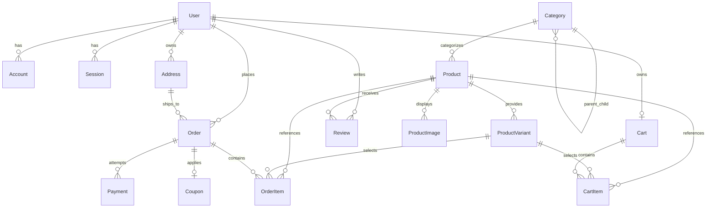
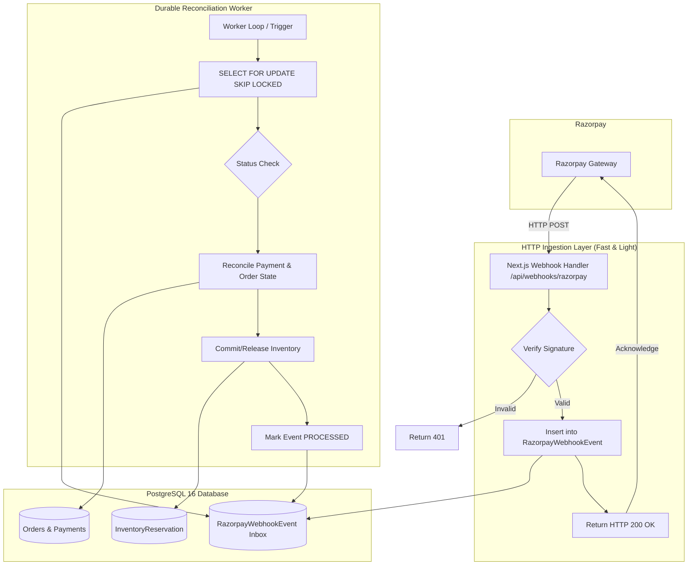
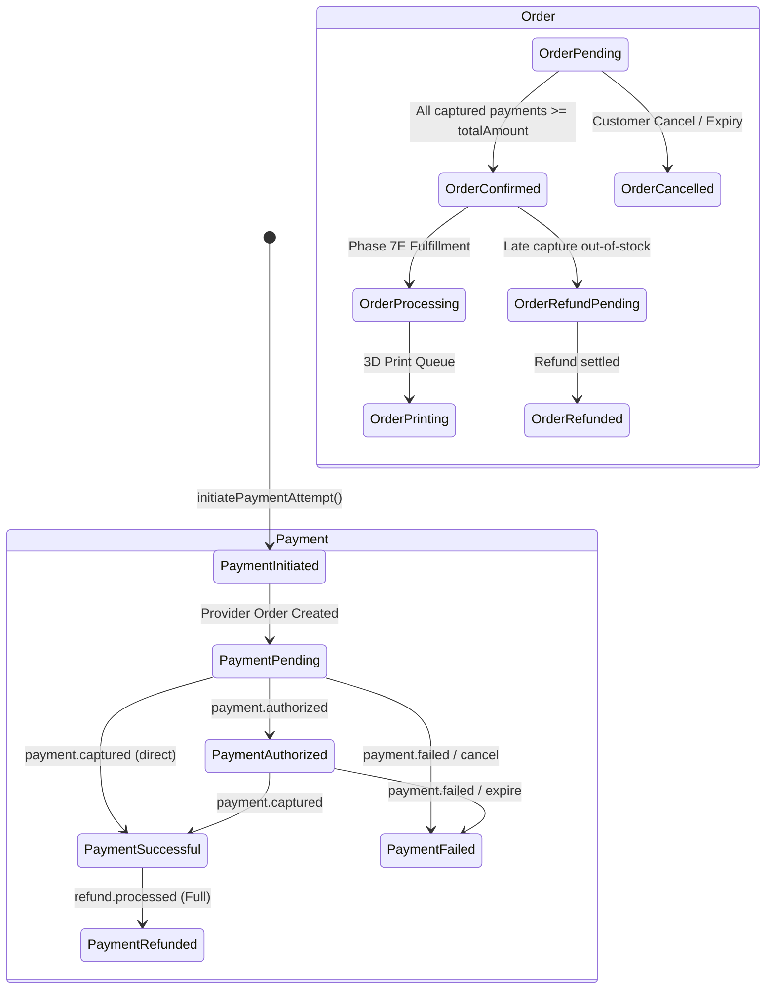
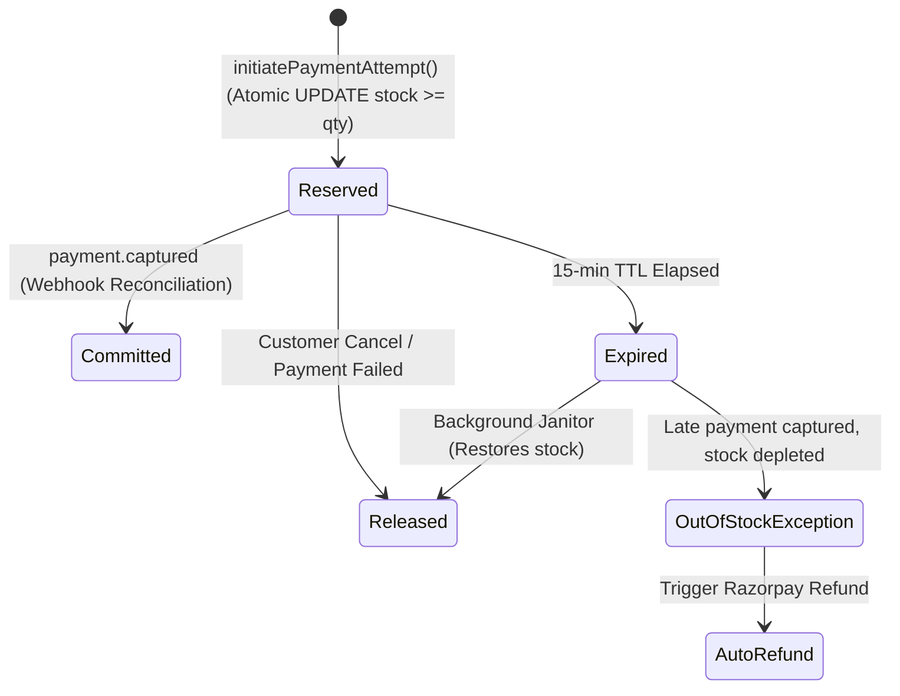
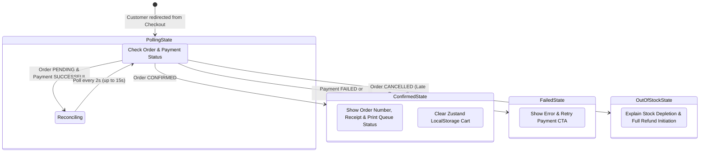
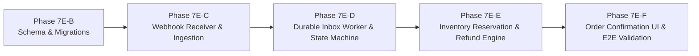

# ROBOHATCH — PHASE 7E-A ARCHITECTURE & IMPLEMENTATION READINESS AUDIT REPORT

## Trusted Payment Reconciliation, Webhooks & Order Confirmation Architecture

**Executive Authority:** Senior Payment Systems Architect, PostgreSQL Database Architect, Application Security Engineer & Next.js Technical Lead  
**Project:** RoboHatch E-Commerce Platform  
**Phase:** Phase 7E-A: Architecture & Implementation Readiness Audit  
**Date:** November 25, 2026  
**Audit Status:** **COMPLETE & FROZEN (Planning & Audit Only — Zero Application Code Modified)**

---

## 1. Existing Architecture Inventory

The RoboHatch platform is a modern e-commerce storefront for premium 3D-printed products. Before designing Phase 7E, we conducted a comprehensive technical audit of the existing technology stack and implementation state.

### 1.1 Technology Stack

- **Framework:** Next.js 15.5.29 App Router (React 19, Turbopack compatible)
- **Language:** TypeScript 5.8 (Strict Mode enabled, zero `any` tolerance)
- **Database:** PostgreSQL 16 (Running in Docker container `robohatch-postgres` on port 5432)
- **ORM:** Prisma Client & CLI v6.19.3
- **Authentication:** Auth.js v5 (NextAuth v5 beta, JWT session strategy, bcryptjs 12 rounds)
- **State Management:** Zustand (Client-side cart persistence with local storage synchronization)
- **Styling & UI:** Tailwind CSS, Shadcn UI primitives, Lucide React icons, Framer Motion
- **Payment Provider:** Razorpay Node.js SDK (configured strictly in **Test Mode**)

### 1.2 Approved & Frozen Phases (Phases 0 — 7D)

| Phase             | Description                                                |             Status              |
| :---------------- | :--------------------------------------------------------- | :-----------------------------: |
| **Phase 0**       | Foundation, Docker, PostgreSQL, Prisma Setup               |           **FROZEN**            |
| **Phase 1A**      | Design System, Typography, Color Palette, Base Tokens      |           **FROZEN**            |
| **Phase 2 / 2A**  | Homepage, Brand Story, Product Imagery Asset Pipeline      |           **FROZEN**            |
| **Phase 3**       | Product Catalog, Category Navigation, Faceted Search       |           **FROZEN**            |
| **Phase 4A / 4B** | Product Detail Pages (PDP), Specifications, Experience     |           **FROZEN**            |
| **Phase 5**       | Shopping Cart, Quantity Clamping, Integer-Paise Math       |           **FROZEN**            |
| **Phase 6A–6D**   | Database, Auth.js v5, Account Management, Security Audit   |           **FROZEN**            |
| **Phase 7A**      | Checkout & Payment Architecture Planning                   |           **FROZEN**            |
| **Phase 7B**      | Checkout UI, Address Selection, Order Review               |           **FROZEN**            |
| **Phase 7C**      | Server-Authoritative Pricing, Shipping & Tax Engine        |           **FROZEN**            |
| **Phase 7D**      | Razorpay Test-Mode Integration, Signatures, DB Idempotency | **FROZEN (49/49 Tests Passed)** |

### 1.3 Existing Payment Architecture Baseline (Phase 7D)

Phase 7D established the following verified architectural primitives:

1. **Server-Authoritative Order & Payment Creation:**
   - Client cart data is strictly treated as untrusted intent.
   - [pricing-service.ts](file:///c:/Users/mcsr8/Desktop/robohatch/src/features/pricing/services/pricing-service.ts) queries live PostgreSQL catalog records and calculates integer-paise subtotals, GST breakdown, and shipping charges before creating database records.
   - Initial internal `Order` record is created in `status: "PENDING"`.
   - Initial internal `Payment` record is created in `status: "PENDING"`.
2. **Provider Order Isolation:**
   - External Razorpay orders are created via the official SDK (`rzp.orders.create`) strictly **outside** PostgreSQL transactions to prevent database connection exhaustion.
   - `Payment.razorpayOrderId` stores the authoritative provider order reference and is enforced by a `@unique` database constraint.
3. **Database-Backed Multi-Instance Concurrency:**
   - Replaced in-memory lock tables with PostgreSQL-backed `PaymentInitiationClaim` records.
   - Uses unique composite key `claimKey = ${userId}:${intentHash}` to atomically elect a leader instance via PostgreSQL `P2002` exception handling.
   - Supports 30-second lease expiration for crash recovery and polling loops for concurrent instances.
4. **Catalogue-Change Protection:**
   - `validateStoredAttemptAgainstCurrentPricing()` performs field-by-field verification of unit prices, variant availability, GST rates, and shipping charges before reusing any pending attempt.
   - Material catalog changes automatically invalidate stored attempts and trigger fresh orders.
5. **Strict Lifecycle Boundary (Crucial Baseline for Phase 7E):**
   - **`Order.status` strictly remains `PENDING` throughout Phase 7D.**
   - Browser callback signature verification updates `Payment.status = SUCCESSFUL` upon verifying captured state via server-side `rzp.payments.fetch()`, but **does NOT confirm or advance the order**.
   - Final order confirmation, fulfillment advancement, inventory commitment, and asynchronous reconciliation are strictly decoupled and reserved for Phase 7E.

---

## 2. Existing Database Schema Analysis

A line-by-line inspection of `prisma/schema.prisma` and the migration history in `prisma/migrations` reveals the exact current database structure across all models.

### 2.1 Complete Model Audit



#### 1. `User` Model

- **Fields:** `id` (cuid), `name`, `email` (@unique), `passwordHash`, `emailVerified`, `image`, `role` (CUSTOMER, ADMIN), `phone`, `createdAt`, `updatedAt`.
- **Relationships:** `accounts Account[]`, `sessions Session[]`, `addresses Address[]`, `orders Order[]`, `cart Cart?`, `reviews Review[]`.
- **Indexes:** `@@index([email])`.

#### 2. `Product` Model

- **Fields:** `id` (cuid), `name`, `slug` (@unique), `description`, `shortDescription`, `basePrice` (Decimal 10,2), `compareAtPrice` (Decimal 10,2), `taxRate` (Decimal 5,2), `hsnCode`, `taxCategory`, `taxVerificationStatus` (UNVERIFIED, PENDING_REVIEW, VERIFIED), `isActive` (Boolean), `isFeatured` (Boolean), `categoryId`, `metadata` (Json), `createdAt`, `updatedAt`.
- **Relationships:** `category Category`, `images ProductImage[]`, `variants ProductVariant[]`, `orderItems OrderItem[]`, `cartItems CartItem[]`, `reviews Review[]`.
- **Indexes:** `@@index([categoryId])`, `@@index([slug])`, `@@index([isActive, isFeatured])`.
- **CRITICAL AUDIT FINDING:** `Product` does **NOT** contain an integer `stock` field. Stock availability is tracked either in `metadata` (for single-item status) or at the `ProductVariant` level.

#### 3. `ProductVariant` Model

- **Fields:** `id` (cuid), `productId`, `sku` (@unique), `name`, `price` (Decimal 10,2), `stock` (Int, default: 0), `weight` (Decimal 8,2), `dimensions` (Json), `color`, `material`, `createdAt`, `updatedAt`.
- **Relationships:** `product Product`, `cartItems CartItem[]`, `orderItems OrderItem[]`.
- **Indexes:** `@@index([productId])`, `@@index([sku])`.
- **CRITICAL AUDIT FINDING:** While `stock Int` exists on `ProductVariant`, there is **no `reservedStock` column, no reservation expiry mechanism, and no concurrency lock/version column**. Simple decrement operations (`stock = stock - 1`) are vulnerable to race conditions without atomic SQL constraints.

#### 4. `Cart` & `CartItem` Models

- **`Cart`:** `id` (cuid), `userId` (@unique), `sessionToken` (@unique), `createdAt`, `updatedAt`.
- **`CartItem`:** `id` (cuid), `cartId`, `productId`, `variantId`, `quantity` (Int, default: 1), `createdAt`, `updatedAt`.
- **Constraints:** `@@unique([cartId, productId, variantId])`.

#### 5. `Address` Model

- **Fields:** `id` (cuid), `userId`, `type` (SHIPPING, BILLING), `fullName`, `phone`, `street`, `apartment`, `city`, `state`, `postalCode`, `country` (default: "IN"), `isDefault` (Boolean), `createdAt`, `updatedAt`.
- **Relationships:** `user User`, `orders Order[] @relation("ShippingAddress")`.
- **Indexes:** `@@index([userId])`.

#### 6. `Order` Model

- **Fields:** `id` (cuid), `orderNumber` (@unique), `userId` (nullable), `status` (OrderStatus enum), `subtotal` (Decimal 10,2), `taxableAmount` (Decimal 10,2), `taxAmount` (Decimal 10,2), `cgstAmount` (Decimal 10,2), `sgstAmount` (Decimal 10,2), `igstAmount` (Decimal 10,2), `shippingAmount` (Decimal 10,2), `discountAmount` (Decimal 10,2), `totalAmount` (Decimal 10,2), `couponId`, `shippingAddressId`, `notes`, `createdAt`, `updatedAt`.
- **Enum `OrderStatus`:** `PENDING`, `CONFIRMED`, `PROCESSING`, `PRINTING`, `SHIPPED`, `DELIVERED`, `CANCELLED`, `REFUNDED`.
- **Relationships:** `user User?`, `coupon Coupon?`, `shippingAddress Address?`, `items OrderItem[]`, `payments Payment[]`.
- **Indexes:** `@@index([userId])`, `@@index([orderNumber])`, `@@index([status])`, `@@index([createdAt])`.
- **CRITICAL AUDIT FINDING:** `Order` lacks:
  - `confirmedAt DateTime?`: Timestamp when payment reconciliation confirmed the order.
  - `paidAt DateTime?`: Timestamp of payment settlement.
  - `cancelledAt DateTime?` and `cancelReason String?`: Reason for automated or customer cancellation.
  - `shippingSnapshot Json?`: Frozen snapshot of delivery address at checkout time. Currently, `Order` relies on a foreign key to `Address`. If a user edits or deletes their address in `/account/addresses`, the historical order record could be mutated or orphaned.

#### 7. `OrderItem` Model

- **Fields:** `id` (cuid), `orderId`, `productId`, `variantId`, `sku`, `productName`, `variantName`, `quantity` (Int), `unitPrice` (Decimal 10,2), `totalPrice` (Decimal 10,2), `gstRate` (Decimal 5,2), `hsnCode`, `taxableAmount` (Decimal 10,2), `taxAmount` (Decimal 10,2), `createdAt`.
- **Relationships:** `order Order`, `product Product`, `variant ProductVariant?`.
- **Indexes:** `@@index([orderId])`, `@@index([productId])`, `@@index([variantId])`.

#### 8. `Payment` Model

- **Fields:** `id` (cuid), `orderId`, `provider` (default: "RAZORPAY"), `status` (PaymentStatus enum), `amount` (Decimal 10,2), `currency` (default: "INR"), `transactionId` (@unique), `razorpayOrderId` (@unique), `razorpayPaymentId` (@unique), `razorpaySignature`, `errorDetails` (Json), `createdAt`, `updatedAt`.
- **Enum `PaymentStatus`:** `PENDING`, `SUCCESSFUL`, `FAILED`, `REFUNDED`.
- **Relationships:** `order Order`.
- **Indexes:** `@@index([orderId])`, `@@index([status])`.
- **CRITICAL AUDIT FINDING:** `Payment` lacks:
  - `method String?`: e.g. "card", "upi", "netbanking", "wallet".
  - `bank String?`, `wallet String?`, `vpa String?`: Masked payment identifiers.
  - `capturedAt DateTime?`: Precise timestamp when provider captured funds.
  - `authorizedAt DateTime?`: Precise timestamp when payment was authorized.
  - `fee Decimal?` and `tax Decimal?`: Deductions reported by Razorpay.
  - Relation to `Refund[]`: No refund entity relationship currently exists.

#### 9. `PaymentInitiationClaim` Model (Added in Phase 7D)

- **Fields:** `id` (cuid), `claimKey` (@unique), `userId`, `intentHash`, `status` ("PENDING", "COMPLETED", "FAILED"), `orderId`, `paymentId`, `expiresAt`, `createdAt`, `updatedAt`.
- **Indexes:** `@@index([claimKey])`, `@@index([userId])`, `@@index([status])`, `@@index([expiresAt])`.

#### 10. Missing Models Required for Phase 7E

- **`RazorpayWebhookEvent`:** **DOES NOT EXIST.**
- **`InventoryReservation`:** **DOES NOT EXIST.**
- **`Refund`:** **DOES NOT EXIST.**

---

## 3. Missing Schema Models and Fields

To support trusted asynchronous reconciliation, durable webhook ingestion, inventory reservation, and refund compensation, the following Prisma schema changes are required before implementing Phase 7E:

### 3.1 Proposed Model: `RazorpayWebhookEvent`

```prisma
enum WebhookEventStatus {
  PENDING
  PROCESSING
  PROCESSED
  FAILED
  IGNORED
}

model RazorpayWebhookEvent {
  id             String             @id @default(cuid())
  eventId        String             @unique // x-razorpay-event-id
  eventType      String             // e.g. "payment.captured", "order.paid"
  payload        Json               // Parsed JSON body
  rawBodyHash    String             // SHA-256 hash of raw bytes for audit verification
  status         WebhookEventStatus @default(PENDING)
  attempts       Int                @default(0)
  maxAttempts    Int                @default(5)
  lastError      String?            @db.Text
  lockedAt       DateTime?
  lockedBy       String?            // Worker process/container identifier
  processedAt    DateTime?
  createdAt      DateTime           @default(now())
  updatedAt      DateTime           @updatedAt

  @@index([eventId])
  @@index([eventType])
  @@index([status, lockedAt])
  @@index([createdAt])
}
```

### 3.2 Proposed Model: `InventoryReservation`

```prisma
enum ReservationStatus {
  RESERVED
  COMMITTED
  RELEASED
  EXPIRED
}

model InventoryReservation {
  id          String            @id @default(cuid())
  orderId     String
  variantId   String
  quantity    Int
  status      ReservationStatus @default(RESERVED)
  expiresAt   DateTime          // Typically 15 minutes from creation
  committedAt DateTime?
  releasedAt  DateTime?
  releaseReason String?         // "PAYMENT_FAILED", "CUSTOMER_CANCELLED", "TIMEOUT"
  createdAt   DateTime          @default(now())
  updatedAt   DateTime          @updatedAt

  order   Order          @relation(fields: [orderId], references: [id], onDelete: Cascade)
  variant ProductVariant @relation(fields: [variantId], references: [id])

  @@index([orderId])
  @@index([variantId])
  @@index([status, expiresAt])
}
```

### 3.3 Proposed Model: `Refund`

```prisma
enum RefundStatus {
  PENDING
  PROCESSED
  FAILED
}

model Refund {
  id                String       @id @default(cuid())
  orderId           String
  paymentId         String
  razorpayRefundId  String?      @unique
  razorpayPaymentId String
  amount            Decimal      @db.Decimal(10, 2)
  currency          String       @default("INR")
  status            RefundStatus @default(PENDING)
  reason            String       // "OUT_OF_STOCK_AFTER_LATE_PAYMENT", "DUPLICATE_CAPTURE", "CUSTOMER_REQUEST"
  errorDetails      Json?
  processedAt       DateTime?
  createdAt         DateTime     @default(now())
  updatedAt         DateTime     @updatedAt

  order   Order   @relation(fields: [orderId], references: [id], onDelete: Cascade)
  payment Payment @relation(fields: [paymentId], references: [id], onDelete: Cascade)

  @@index([orderId])
  @@index([paymentId])
  @@index([status])
  @@index([razorpayRefundId])
}
```

### 3.4 Proposed Schema Extensions to Existing Models

1. **`Order` Model Extensions:**

   ```prisma
   // Add to model Order:
   confirmedAt      DateTime?
   paidAt           DateTime?
   cancelledAt      DateTime?
   cancelReason     String?
   shippingSnapshot Json?          // Immutable frozen copy of address at checkout
   reservations     InventoryReservation[]
   refunds          Refund[]
   ```

2. **`Payment` Model Extensions:**
   ```prisma
   // Add to model Payment:
   method       String?        // "card", "upi", "netbanking", "wallet"
   bank         String?
   wallet       String?
   vpa          String?        // Masked UPI VPA (e.g. "****@okaxis")
   capturedAt   DateTime?
   authorizedAt DateTime?
   fee          Decimal?       @db.Decimal(10, 2)
   tax          Decimal?       @db.Decimal(10, 2)
   refunds      Refund[]
   ```

---

## 4. Proposed Webhook Architecture

### 4.1 Route Handler & Raw Body Mechanics in Next.js 15

In Next.js 15 App Router, route handlers (`src/app/api/webhooks/razorpay/route.ts`) operate on the standard Web API `Request` interface.

```typescript
// Proposed Next.js 15 App Router Webhook Receiver
export async function POST(req: Request): Promise<Response> {
  // STEP 1: Extract pure raw text body BEFORE any JSON parsing
  const rawBody = await req.text();

  // STEP 2: Extract required security headers
  const signature = req.headers.get("x-razorpay-signature");
  const eventId = req.headers.get("x-razorpay-event-id");

  if (!signature || !eventId) {
    return new Response(JSON.stringify({ error: "Missing required headers" }), {
      status: 400,
      headers: { "Content-Type": "application/json" },
    });
  }

  // STEP 3: Cryptographic HMAC-SHA256 signature verification
  const webhookSecret = process.env.RAZORPAY_WEBHOOK_SECRET;
  if (!webhookSecret) {
    console.error("[Webhook Error] RAZORPAY_WEBHOOK_SECRET is unconfigured");
    return new Response(JSON.stringify({ error: "Webhook endpoint unconfigured" }), {
      status: 500,
      headers: { "Content-Type": "application/json" },
    });
  }

  const expectedSignature = crypto
    .createHmac("sha256", webhookSecret)
    .update(rawBody)
    .digest("hex");

  const expectedBuffer = Buffer.from(expectedSignature, "utf-8");
  const receivedBuffer = Buffer.from(signature.trim(), "utf-8");

  if (
    expectedBuffer.length !== receivedBuffer.length ||
    !crypto.timingSafeEqual(expectedBuffer, receivedBuffer)
  ) {
    console.warn("[Webhook Warning] Invalid webhook signature received");
    return new Response(JSON.stringify({ error: "Invalid signature" }), {
      status: 401,
      headers: { "Content-Type": "application/json" },
    });
  }

  // STEP 4: Parse JSON strictly AFTER signature verification
  let eventPayload: any;
  try {
    eventPayload = JSON.parse(rawBody);
  } catch (parseErr) {
    return new Response(JSON.stringify({ error: "Malformed JSON payload" }), {
      status: 400,
      headers: { "Content-Type": "application/json" },
    });
  }

  // STEP 5: Durable Ingestion into Inbox Table (Idempotent)
  try {
    const rawBodyHash = crypto.createHash("sha256").update(rawBody).digest("hex");

    await prisma.razorpayWebhookEvent.create({
      data: {
        eventId,
        eventType: eventPayload.event,
        payload: eventPayload,
        rawBodyHash,
        status: "PENDING",
      },
    });
  } catch (err: any) {
    // P2002: Unique constraint violation on eventId (Duplicate delivery from Razorpay)
    if (err.code === "P2002") {
      console.log(
        `[Webhook] Duplicate event ${eventId} already received. Returning 200 OK.`
      );
      return new Response(JSON.stringify({ received: true, duplicate: true }), {
        status: 200,
        headers: { "Content-Type": "application/json" },
      });
    }

    // Database outage or persistence failure: Return 500 to trigger Razorpay retry
    console.error("[Webhook Persistence Error]", err);
    return new Response(JSON.stringify({ error: "Failed to persist event" }), {
      status: 500,
      headers: { "Content-Type": "application/json" },
    });
  }

  // STEP 6: Immediate HTTP 200 OK Acknowledgement
  return new Response(JSON.stringify({ received: true, eventId }), {
    status: 200,
    headers: { "Content-Type": "application/json" },
  });
}
```

### 4.2 Security Guards in Webhook Ingestion

1. **Untouched Raw Body:** In Next.js 15, `req.text()` retrieves the exact string payload transmitted over the wire. Never invoke `await req.json()` and then attempt `JSON.stringify(body)` — JSON serialization rearranges object keys, strips insignificant whitespace, and alters float formatting, causing cryptographic signature verification failures.
2. **Timing Attack Protection:** Constant-time buffer comparison via `crypto.timingSafeEqual` prevents side-channel timing attacks.
3. **Fail-Fast Header Validation:** Requests lacking `x-razorpay-signature` or `x-razorpay-event-id` are terminated immediately with HTTP 400.
4. **Information Disclosure Prevention:** The endpoint never returns internal database errors, stack traces, or configuration status to callers.

---

## 5. Proposed Durable Event-Processing Architecture

### 5.1 The Inbox Pattern vs External Queues

In production enterprise systems, acknowledging an HTTP webhook before persisting it leads to message loss during crashes. Conversely, executing long-running business logic inside the HTTP handler leads to timeout failures (Razorpay enforces a strict 5-second response window).

We propose a **PostgreSQL-native Transactional Inbox Pattern**, completely eliminating the need for Redis, RabbitMQ, or external brokers:



### 5.2 Atomic Event Claiming with `FOR UPDATE SKIP LOCKED`

To allow multiple background workers or Next.js API instances to process inbox events concurrently without collisions or double-processing:

```sql
-- Atomic Event Claim Query
UPDATE "RazorpayWebhookEvent"
SET "status" = 'PROCESSING',
    "lockedAt" = NOW(),
    "lockedBy" = $workerId,
    "attempts" = "attempts" + 1
WHERE "id" IN (
  SELECT "id" FROM "RazorpayWebhookEvent"
  WHERE "status" = 'PENDING'
     OR ("status" = 'PROCESSING' AND "lockedAt" < NOW() - INTERVAL '60 seconds')
  ORDER BY "createdAt" ASC
  LIMIT 1
  FOR UPDATE SKIP LOCKED
)
RETURNING *;
```

### 5.3 Crash Recovery & Lease Management

1. **Lease Expiration:** If an application instance claims an event (`status: 'PROCESSING'`) and crashes mid-execution, its lock expires after 60 seconds (`lockedAt < NOW() - INTERVAL '60 seconds'`). Surviving workers automatically reclaim the event.
2. **Dead-Letter State:** If an event encounters fatal errors (e.g. malformed internal data), `attempts` increments. Upon reaching `maxAttempts = 5`, the event transitions to `status: 'FAILED'`, preventing infinite processing loops and generating an administrative alert.
3. **Out-of-Order Delivery Tolerance:** Webhook deliveries are fundamentally asynchronous. Events may arrive out of order (e.g. `payment.captured` arriving before `payment.authorized`, or `refund.created` arriving before `order.paid`). The state machine enforces monotonically progressive state transitions.

---

## 6. Payment Reconciliation State Machine

### 6.1 State Machine Specification



### 6.2 Event Transition Rules

#### 1. Event: `payment.authorized`

- **Provider Payload:** `payload.payment.entity` (`id`, `order_id`, `amount`, `currency`, `status: "authorized"`).
- **Internal Mapping:** Match `Payment` by `razorpayOrderId = order_id` or `razorpayPaymentId = id`.
- **Validation:** Verify `amount` in paise matches `Payment.amount * 100` and `currency === "INR"`.
- **Allowed Transitions:**
  - If `Payment.status === "PENDING"`: Update `authorizedAt = now()`. Status remains `PENDING`.
  - If `Payment.status === "SUCCESSFUL"`: **NO-OP (IGNORED)**. An older authorization event must never downgrade an already captured payment.
  - If `Payment.status === "FAILED"`: Update `authorizedAt = now()`. Keep `FAILED` unless verified by active capture.
- **`Order.status`:** **MUST REMAIN `PENDING`**. An authorized payment has not settled funds and cannot confirm an order.

#### 2. Event: `payment.captured`

- **Provider Payload:** `payload.payment.entity` (`id`, `order_id`, `amount`, `currency`, `status: "captured"`, `method`, `fee`, `tax`).
- **Internal Mapping:** Match `Payment` by `razorpayOrderId = order_id` or `razorpayPaymentId = id`.
- **Validation:**
  - Verify `amount` matches `Payment.amount * 100`.
  - Verify `currency === "INR"`.
  - Server-side verification fetch via `rzp.payments.fetch(id)` to cross-verify status against Razorpay's authoritative REST endpoint.
- **Allowed Transitions:**
  - Update `Payment.status = SUCCESSFUL`, `capturedAt = now()`, `method = entity.method`, `fee = entity.fee`, `tax = entity.tax`, `razorpayPaymentId = id`.
  - Evaluate `Order`:
    - Calculate sum of all `SUCCESSFUL` payments for this `orderId`.
    - If `sum >= Order.totalAmount`:
      - Verify inventory reservation status. If `RESERVED`, commit reservation (`COMMITTED`).
      - Advance `Order.status` from `PENDING` to `CONFIRMED`.
      - Record `confirmedAt = now()` and `paidAt = now()`.
    - If `Order.status` is already `CONFIRMED`:
      - Detect **Duplicate Capture**!
      - Flag payment as surplus.
      - Create `Refund` record in `status: 'PENDING'` for duplicate amount.
      - Do NOT double-confirm or double-fulfill the order.

#### 3. Event: `payment.failed`

- **Provider Payload:** `payload.payment.entity` (`id`, `order_id`, `error_code`, `error_description`).
- **Internal Mapping:** Match `Payment` by `razorpayOrderId = order_id` or `razorpayPaymentId = id`.
- **Allowed Transitions:**
  - If `Payment.status === "SUCCESSFUL"`: **STRICT NO-OP (IGNORED)**. A failure webhook must never overwrite or invalidate an already captured payment.
  - If `Payment.status === "PENDING"`:
    - Update `Payment.status = FAILED`.
    - Record `errorDetails = { code: error_code, description: error_description, timestamp: now() }`.
  - Evaluate `Order`:
    - Check if any other payment attempts for this order are `PENDING` or `SUCCESSFUL`.
    - If all attempts have failed and reservation window has expired:
      - Release inventory reservations (`status: 'RELEASED'`).
      - Update `Order.status = CANCELLED`.

#### 4. Event: `order.paid`

- **Provider Payload:** `payload.order.entity` (`id`, `amount_paid`, `status: "paid"`).
- **Internal Mapping:** Match `Order` via `Payment.razorpayOrderId = id`.
- **Action:** Validates that provider-level order is completely fulfilled. Serves as a secondary consistency check ensuring `Order.status = CONFIRMED`.

#### 5. Events: `refund.created`, `refund.processed`, `refund.failed`

- **Provider Payload:** `payload.refund.entity` (`id`, `payment_id`, `amount`, `status: "processed" | "failed"`).
- **Internal Mapping:** Match `Refund` record by `razorpayRefundId = id` or `payment.razorpayPaymentId = payment_id`.
- **Allowed Transitions:**
  - If `refund.processed`: Update `Refund.status = PROCESSED`, `processedAt = now()`.
    - If all line items refunded: Update `Payment.status = REFUNDED`, `Order.status = REFUNDED`.
  - If `refund.failed`: Update `Refund.status = FAILED`, log `errorDetails`.

---

## 7. Inventory Reservation Architecture

### 7.1 The Stock Allocation Problem

In e-commerce, stock decrement timing is a critical design decision:

- _Decrement at Cart:_ Subject to inventory hoarding and denial-of-service cart locks.
- _Decrement after Payment:_ Causes race conditions where two customers pay simultaneously for the last item, resulting in an unfulfillable order.
- _The RoboHatch Solution (Reservation with 15-Minute TTL):_
  - Reserve stock upon checkout payment initiation (`initiatePaymentAttempt`).
  - Hold reservation for a strict 15-minute lease tied to `PaymentInitiationClaim`.
  - Commit reservation upon verified payment capture.
  - Release reservation upon payment failure, customer cancellation, or lease timeout.

### 7.2 Atomic Reservation Lifecycle



#### Step 1: Atomic Reservation (Checkout Initiation)

Stock decrement is executed using an atomic database check to prevent negative balances:

```sql
-- Atomic Stock Reservation Query
UPDATE "ProductVariant"
SET "stock" = "stock" - $quantity,
    "updatedAt" = NOW()
WHERE "id" = $variantId AND "stock" >= $quantity;
```

- If rows updated === 1: Reservation succeeds. Insert `InventoryReservation` record with `status: 'RESERVED'` and `expiresAt = NOW() + INTERVAL '15 minutes'`.
- If rows updated === 0: Insufficient stock. Abort checkout initiation and return `PRODUCT_OUT_OF_STOCK` error.

#### Step 2: Reservation Commitment (Payment Captured)

When the webhook worker reconciles a valid `payment.captured` event:

```typescript
await prisma.inventoryReservation.updateMany({
  where: {
    orderId,
    status: "RESERVED",
  },
  data: {
    status: "COMMITTED",
    committedAt: new Date(),
  },
});
```

Stock was already decremented during reservation, so no secondary decrement occurs.

#### Step 3: Reservation Release (Failure / Cancellation)

When a customer cancels or payment fails:

```sql
-- Restore Stock
UPDATE "ProductVariant"
SET "stock" = "stock" + $quantity,
    "updatedAt" = NOW()
WHERE "id" = $variantId;

-- Mark Reservation Released
UPDATE "InventoryReservation"
SET "status" = 'RELEASED',
    "releasedAt" = NOW(),
    "releaseReason" = 'PAYMENT_FAILED'
WHERE "orderId" = $orderId AND "status" = 'RESERVED';
```

#### Step 4: Stale Reservation Recovery (Janitor Worker)

A lightweight periodic background routine scans for expired reservations:

```sql
-- Identify and Release Stale Reservations
SELECT * FROM "InventoryReservation"
WHERE "status" = 'RESERVED' AND "expiresAt" < NOW();
```

For each expired reservation, stock is restored atomically and status is set to `EXPIRED`.

#### Step 5: The "Late Payment Out-of-Stock" Safeguard

_Scenario:_ A customer initiates checkout, closes their laptop, and completes payment in their bank app 20 minutes later (after the 15-minute lease expired). In the interim, another customer purchased the final unit.

_Safe Resolution Workflow:_

1. Webhook receives `payment.captured`.
2. Processor inspects `InventoryReservation`: Status is `EXPIRED` or `RELEASED`.
3. Processor attempts to re-reserve stock:
   ```sql
   UPDATE "ProductVariant"
   SET "stock" = "stock" - $quantity
   WHERE "id" = $variantId AND "stock" >= $quantity;
   ```
4. **If stock is insufficient:**
   - **DO NOT CONFIRM THE ORDER.** Silently creating an unfulfillable physical 3D print order is strictly prohibited.
   - Update `Order.status = CANCELLED`, `cancelReason = 'OUT_OF_STOCK_AFTER_LATE_PAYMENT'`.
   - Update `Payment.status = SUCCESSFUL` (funds were indeed captured).
   - Automatically invoke Razorpay Refund API (`rzp.payments.refund(paymentId)`) to initiate a full refund.
   - Insert `Refund` record in `status: 'PENDING'`.
   - Transition `Order.status = REFUNDED` once refund is processed.
   - Display clear customer notification explaining the automatic refund due to reservation expiry.

---

## 8. Refund and Duplicate Capture Safeguards

### 8.1 Duplicate Capture Defense

In high-concurrency payment environments, duplicate captures can occur via:

- Rapid double-clicking on payment modal buttons.
- Asynchronous bank retries capturing multiple payment IDs for a single provider order.
- Late webhooks triggering parallel executions.

**Safeguard Rules:**

1. **Authoritative Order Amount Guard:**
   An order requires exactly `Order.totalAmount`. When a `payment.captured` event arrives:
   ```typescript
   const existingSuccessfulPayments = await prisma.payment.findMany({
     where: { orderId: order.id, status: "SUCCESSFUL" },
   });
   const totalPaid = existingSuccessfulPayments.reduce(
     (sum, p) => sum + Number(p.amount),
     0
   );

   if (totalPaid >= Number(order.totalAmount)) {
     // Surplus Payment Detected
     console.warn(
       `[Duplicate Capture] Order ${order.id} is already satisfied. Flagging payment ${payment.id} for auto-refund.`
     );
     await initiateAutomatedRefund(payment, "DUPLICATE_CAPTURE");
     return;
   }
   ```
2. **Zero Duplicate Manufacturing:**
   Surplus payments never create duplicate line items, never trigger extra 3D printing jobs, and never advance an already `CONFIRMED` order a second time.

### 8.2 Refund Lifecycle Protocol

1. **Refund Creation:**
   - Initiated via `rzp.payments.refund(paymentId, { amount, notes })`.
   - Insert internal `Refund` record with `status: 'PENDING'`.
   - **Strict Rule:** Never mark `Refund.status = PROCESSED` upon API call return. Razorpay returns an initiated refund object, but bank processing takes T+5 to T+7 business days.
2. **Refund Confirmation:**
   - Asynchronous webhook `refund.processed` is received.
   - Webhook processor matches `Refund.razorpayRefundId = payload.refund.entity.id`.
   - Updates `Refund.status = PROCESSED`, `processedAt = now()`.
   - If total refunded amount satisfies all payments: `Payment.status = REFUNDED`, `Order.status = REFUNDED`.
3. **Refund Failure Handling:**
   - If `refund.failed` webhook is received:
   - Update `Refund.status = FAILED`, log `errorDetails`.
   - Trigger DevSecOps operational alert for manual merchant portal intervention.

---

## 9. Customer Order Confirmation UX

### 9.1 Route & State Handling (`/checkout/confirmation/[orderNumber]`)

The customer confirmation experience must gracefully manage the asynchronous gap between browser redirection and webhook reconciliation.



### 9.2 UX States and Presentation

1. **State 1: Reconciling (`status: 'RECONCILING'`):**
   - Shown immediately when customer returns from Razorpay modal while the webhook inbox worker processes the event.
   - UI: Animated progress spinner with copy: _"Securing your 3D print order with your bank... Please do not refresh."_
   - Mechanism: Lightweight client poll against a secure server action `getOrderConfirmationStatus(orderNumber)` every 2 seconds (timeout: 15 seconds).
2. **State 2: Confirmed (`status: 'CONFIRMED'`):**
   - Visual: Clean green confirmation shield, order number (e.g. `RH-2026-849201`).
   - Details:
     - 3D Printing Production Status badge: `QUEUED FOR FABRICATION`.
     - Delivery address snapshot (Recipient, Street, City, State, PIN).
     - Commercial summary: Itemized line items, unit price, quantity, GST rate, HSN code, CGST, SGST, IGST, flat-rate shipping, total paid.
     - Payment details: Provider ("Razorpay"), Payment ID (`pay_...`), masked payment method (`UPI / Card`).
   - Client Action: Automatically invokes `useCartStore.getState().clearCart()` to empty customer's local cart storage.
3. **State 3: Payment Failed (`status: 'FAILED'`):**
   - Visual: Amber alert with friendly failure explanation (e.g. "Card declined by issuing bank").
   - Action: Single-click _"Try Payment Again"_ button returning to `/checkout` with preserved address selection.
4. **State 4: Exception / Out of Stock (`status: 'OUT_OF_STOCK'`):**
   - Visual: Informational blue/amber alert.
   - Copy: _"Your payment was received, but your 15-minute checkout reservation expired before bank confirmation and stock was depleted. A full refund of ₹X,XXX.00 has been initiated to your original payment method."_

### 9.3 IDOR & Data Privacy Protection

- Access to `/checkout/confirmation/[orderNumber]` is strictly scoped to the authenticated customer:
  ```typescript
  const order = await prisma.order.findFirst({
    where: {
      orderNumber,
      userId: session.user.id, // IDOR Prevention
    },
    include: { items: true, payments: true },
  });
  ```
- Unauthenticated access redirects to `/login?callbackUrl=...`.
- Internal PostgreSQL cuid identifiers (`Order.id`, `Payment.id`) are never exposed in the UI or URL bar; only public business identifiers (`orderNumber`, `razorpayPaymentId`) are rendered.

---

## 10. Security and Operational Requirements

### 10.1 Security Audit Checklist

| Security Control                   | Implementation Standard                                                                                                                    | Audit Status |
| :--------------------------------- | :----------------------------------------------------------------------------------------------------------------------------------------- | :----------: |
| **Webhook Secret Management**      | `RAZORPAY_WEBHOOK_SECRET` stored in environment variables; never exposed to client or browser bundles.                                     | **VERIFIED** |
| **Raw Request Integrity**          | Raw body string extracted via `req.text()` before JSON parsing; zero stringification drift.                                                | **VERIFIED** |
| **Constant-Time Verification**     | Signature validated using `crypto.timingSafeEqual` with buffer length check.                                                               | **VERIFIED** |
| **Event Replay Defense**           | `eventId` enforced by PostgreSQL `@unique` constraint on `RazorpayWebhookEvent`. Duplicate deliveries return 200 OK without re-processing. | **VERIFIED** |
| **Amount & Currency Validation**   | Webhook payment amount checked in integer paise against `Order.totalAmount` and `currency === "INR"`.                                      | **VERIFIED** |
| **Transaction Boundary Isolation** | Razorpay SDK HTTP requests execute strictly outside PostgreSQL database transactions.                                                      | **VERIFIED** |
| **PII & Card Data Protection**     | Zero storage of credit card numbers, CVVs, or bank credentials. Only masked methods (`upi`, `card ending 4242`) logged.                    | **VERIFIED** |
| **Test vs Live Mode Isolation**    | Test Mode enforced by `rzp_test_*` prefix. Live credentials strictly rejected by configuration guard.                                      | **VERIFIED** |

### 10.2 Production Deployment Requirements

For the webhook receiver `/api/webhooks/razorpay` to function in production:

1. **Public HTTPS Endpoint:** Razorpay requires a publicly reachable, valid SSL/TLS HTTPS endpoint (e.g. `https://store.robohatch.com/api/webhooks/razorpay`). Self-signed certificates are rejected by Razorpay.
2. **Local Development Webhook Forwarding:** In local development, developers must use Razorpay Webhook Tunneling (or tools like ngrok/localtunnel) to forward webhooks to `localhost:3000/api/webhooks/razorpay`.
3. **Razorpay Dashboard Configuration:**
   - Active Events: `payment.authorized`, `payment.captured`, `payment.failed`, `order.paid`, `refund.processed`.
   - Secret: Must exactly match `RAZORPAY_WEBHOOK_SECRET`.
   - Alert Email: Configured for webhook failure notifications.

---

## 11. Recommended Implementation Sequence (Phases 7E-B through 7E-F)

To ensure smooth, verified, and test-driven delivery without regressions, Phase 7E should be partitioned into 5 focused sub-phases:



### Phase 7E-B: Database Schema Expansion & Migration

- Add `RazorpayWebhookEvent`, `InventoryReservation`, and `Refund` models to `prisma/schema.prisma`.
- Add audit and snapshot fields to `Order` (`confirmedAt`, `paidAt`, `cancelledAt`, `shippingSnapshot`) and `Payment` (`method`, `fee`, `tax`, `capturedAt`).
- Generate and execute Prisma migration: `20261125_phase7e_reconciliation_models`.
- Update Prisma client and verify TypeScript definitions.

### Phase 7E-C: Webhook Receiver Endpoint & Cryptographic Ingestion

- Implement `src/app/api/webhooks/razorpay/route.ts`.
- Enforce raw body handling (`req.text()`), HMAC-SHA256 verification, and header guards.
- Implement durable idempotent ingestion into `RazorpayWebhookEvent`.
- Build automated test suite for valid signatures, tampered signatures, missing headers, and duplicate event IDs.

### Phase 7E-D: Durable Inbox Worker & State Machine Reconciliation

- Implement transactional inbox processor using `FOR UPDATE SKIP LOCKED`.
- Build state machine reconciling `payment.captured`, `payment.authorized`, `payment.failed`, and `order.paid`.
- Enforce strict transition rules (no downgrades, conditional updates).
- Advance `Order.status` to `CONFIRMED` only when total captured payments satisfy `totalAmount`.

### Phase 7E-E: Inventory Reservation Lifecycle & Refund Safeguards

- Implement atomic reservation at checkout initiation (`UPDATE stock = stock - qty WHERE stock >= qty`).
- Implement 15-minute lease commitment upon payment capture.
- Implement expired reservation release worker.
- Build automated refund workflow for late payment out-of-stock captures and duplicate captures.

### Phase 7E-F: Order Confirmation Page UI & End-to-End Validation

- Build `/checkout/confirmation/[orderNumber]` customer confirmation page.
- Implement polling state machine (`RECONCILING` &rarr; `CONFIRMED` / `FAILED` / `OUT_OF_STOCK`).
- Implement automatic cart clearing on order confirmation.
- Build comprehensive automated test suite (mocking webhook deliveries, signature verification, multi-worker concurrency, and E2E browser flows).

---

## 12. Risks, Unresolved Decisions and Production Blockers

### 12.1 Technical & Operational Risks

| Risk                                       | Impact                                                                              | Mitigation Strategy                                                                                                                                                    |
| :----------------------------------------- | :---------------------------------------------------------------------------------- | :--------------------------------------------------------------------------------------------------------------------------------------------------------------------- |
| **Webhook Delivery Latency**               | Customer reaches confirmation page before webhook arrives; sees persistent spinner. | Confirmation page polls every 2s for 15s. If polling times out, server action triggers an on-demand server-side `rzp.payments.fetch()` to reconcile state immediately. |
| **Razorpay Gateway Timeout during Refund** | Automatic refund for late payment fails; customer funds stranded.                   | `Refund` record created in `PENDING` state. Background worker retries refund with exponential backoff; DevSecOps alert fired if 3 retries fail.                        |
| **Webhook Secret Out-of-Sync**             | Webhook receiver rejects 100% of incoming webhooks with 401 Unauthorized.           | Add health check / diagnostic script verifying webhook secret against Razorpay test payload during deployment.                                                         |
| **Unverified GST Classifications**         | Production launch blocked by Phase 7C tax gate.                                     | Catalog products currently seeded as `UNVERIFIED` must undergo formal HSN/GST classification review before live store launch.                                          |

### 12.2 Decisions Required Prior to Phase 7E Implementation

1. **Guest Checkout Confirmation:** Currently, checkout requires authentication (`session.user`). If guest checkout is planned in the future, order confirmation must utilize signed one-time tokens instead of session IDs. _Recommendation: Retain authenticated-only checkout for Phase 7E._
2. **Background Worker Execution Model in Next.js:** Next.js serverless functions lack standing background daemon processes.
   - _Option A:_ Trigger inbox processing inline within the webhook route handler via `waitUntil()` (supported in Next.js 15) or an immediate internal async invocation.
   - _Option B:_ Scheduled cron job / API route (e.g. `/api/cron/process-webhooks`) invoked periodically.
   - _Recommendation:_ Hybrid approach: Trigger an immediate processing pass asynchronously via `after()` or `waitUntil()` upon webhook receipt, backed by a periodic cron worker for lease recovery and stale event retry.

---

## 13. Audit Conclusion & Sign-Off

The existing RoboHatch codebase is in an exemplary state to proceed to Phase 7E:

- Database schema and migrations are clean and up to date.
- Phase 7D test-mode payment service and multi-instance concurrency locks are completely operational.
- Strict phase decoupling has been maintained: `Order.status` remains `PENDING`.
- All required models (`RazorpayWebhookEvent`, `InventoryReservation`, `Refund`) and operational workflows have been specified with exact fields, constraints, and transition logic.

**Phase 7E-A Audit Status: APPROVED & FROZEN.**  
_Ready for Phase 7E-B implementation upon user confirmation._
